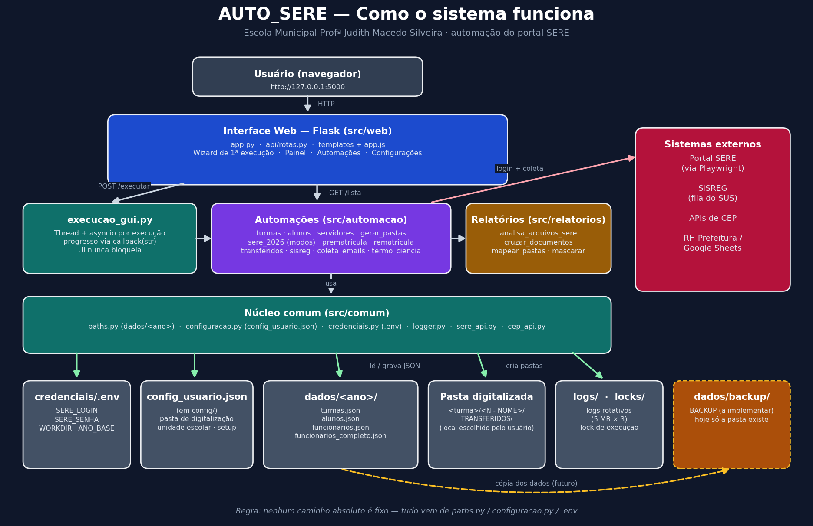
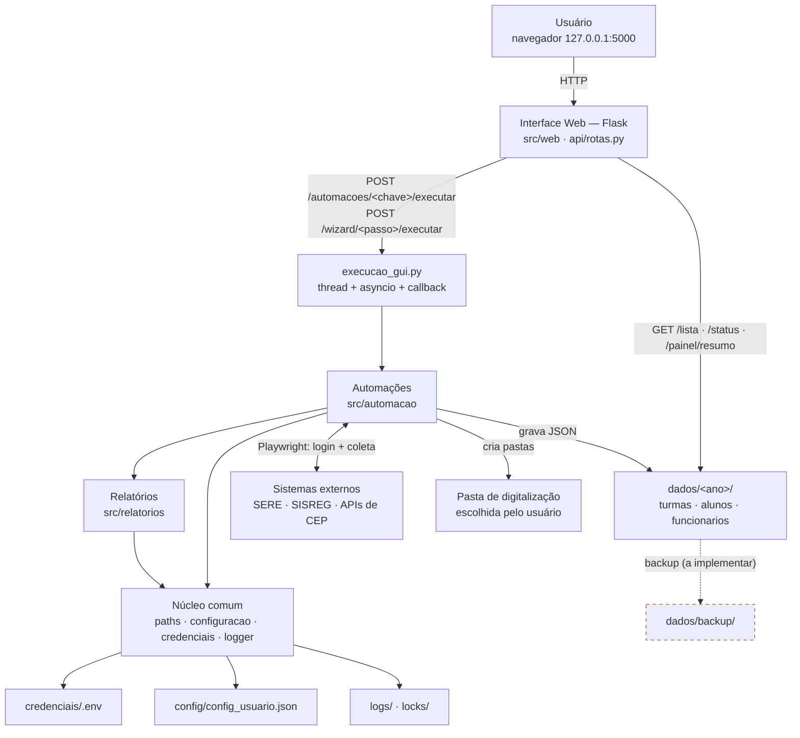
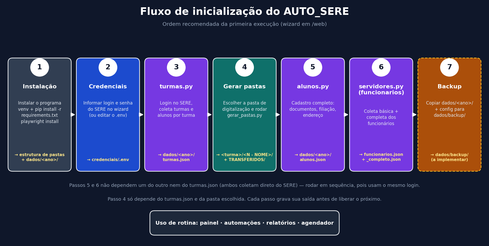
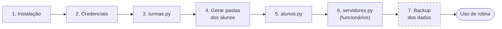

# Diagrama de funcionamento — AUTO_SERE

> Escola Municipal Profª Judith Macedo Silveira · automação do portal SERE
> Base da análise: `AUTO_SERE.zip` (118 arquivos), `AUTO_SERE_MAPA.txt`, `RELATORIO_IO.md` (68 scripts analisados por AST) e leitura direta de `paths.py`, `configuracao.py`, `rotas.py`, `turmas.py`, `alunos.py`, `servidores.py` e `gerar_pastas.py`.



---

## 1. Visão geral

O AUTO_SERE é um conjunto de automações em Python (Playwright) que entram no portal SERE, coletam turmas, alunos e funcionários, organizam as pastas de digitalização e geram relatórios. Tudo é operado por uma interface web local em Flask (`python -m src.web.app` → `http://127.0.0.1:5000`).

| Camada | Pasta | Papel |
|---|---|---|
| Interface | `src/web` | Flask + HTML/CSS/JS puro. Wizard de 1ª execução, painel, lista de automações, configurações. Endpoints em `api/rotas.py`. |
| Ponte assíncrona | `src/comum/execucao_gui.py` | Cada automação roda em sua própria thread com event loop asyncio; o progresso volta por `callback(str)`. A tela nunca trava. |
| Automações | `src/automacao` | Um módulo por tarefa: `turmas`, `alunos`, `servidores`, `gerar_pastas`, `sere_2026` (modos), `prematricula_*`, `rematricula_*`, `processo_transferidos`, `sisreg`, `coleta_emails`, `termo_ciencia`. |
| Relatórios | `src/relatorios` | `analisa_arquivos_sere`, `analisa_documentos_pc`, `cruzar_documentos`, `mapear_pastas_alunos`, `mascarar`. |
| Núcleo comum | `src/comum` | `paths.py` (caminhos), `configuracao.py` (preferências do usuário), `credenciais.py` (.env), `logger.py`, `sere_api.py`, `cep_api.py`. |
| Persistência | `dados/`, `config/`, `credenciais/`, `logs/`, `locks/` | JSONs por ano letivo, configuração, segredos, logs rotativos e locks. |

**Regra de ouro:** nenhum caminho é fixo no código. Tudo é resolvido por `paths.py` (dados em `dados/<ano>/`), `configuracao.py` (pasta de digitalização, escolhida pelo usuário) e variáveis do `.env`.

---

## 2. Arquitetura (diagrama)



---

## 3. Fluxo de inicialização





### Passo a passo

| # | Etapa | O que acontece | Entrada | Saída | Como confirmar |
|---|---|---|---|---|---|
| 1 | **Instalação** | Instalar o programa; criar `.venv`, `pip install -r requirements.txt`, `playwright install`. `garantir_diretorios_runtime()` cria `logs/`, `locks/`, `dados/backup/` e `dados/<ano>/`. | — | Estrutura de pastas | `pytest tests/` (inclui `test_ambiente.py`) |
| 2 | **Credenciais** | Informar login e senha do SERE no wizard (`credenciais_sere`) ou copiar `.env.example` → `credenciais/.env`. O wizard grava o `.env` e recarrega em runtime. | `SERE_LOGIN`, `SERE_SENHA` | `credenciais/.env` | `GET /wizard/status` → `credenciais_sere: true` |
| 3 | **`turmas.py`** | Login no SERE via Playwright, coleta turmas e alunos de cada turma. | Credenciais | `dados/<ano>/turmas.json` | `wizard/status` → `turmas: true` |
| 4 | **Gerar pastas** | Usuário escolhe a pasta de digitalização (persistida em `config_usuario.json`); `gerar_pastas.py` cria `<turma>/<N - NOME>/` e move para `TRANSFERIDOS/` quem saiu do `turmas.json` ou está "Transferido". | `turmas.json` + pasta escolhida | Árvore de pastas | `wizard/status` → `gerar_pastas: true` |
| 5 | **`alunos.py`** | Coleta o cadastro completo de cada aluno (documentos, filiação, endereço). | Credenciais | `dados/<ano>/alunos.json` | `wizard/status` → `alunos: true` |
| 6 | **`servidores.py`** (funcionários) | Coleta básica e completa dos funcionários. | Credenciais | `funcionarios.json` e `funcionarios_completo.json` | `wizard/status` → `funcionarios: true` |
| 7 | **Backup** | Copiar `dados/<ano>/` e configuração para `dados/backup/` com data. **Ainda não implementado** (ver seção 6). | `dados/<ano>/` | `dados/backup/<data>/` | — |

**Ordem e dependências.** O passo 4 depende de `turmas.json`. Os passos 5 e 6 não dependem um do outro nem do `turmas.json`, pois coletam direto do SERE; rode-os em sequência, já que compartilham o mesmo login. No wizard atual a ordem exibida é `credenciais → turmas → gerar_pastas → funcionarios → alunos`; a ordem acima (alunos antes de funcionários) funciona igualmente.

---

## 4. Ciclo de uma automação em execução

```mermaid
sequenceDiagram
    actor U as Usuário
    participant W as Flask (rotas.py)
    participant G as execucao_gui
    participant T as Thread + asyncio
    participant S as Portal SERE
    participant F as dados/&lt;ano&gt;/*.json

    U->>W: POST /automacoes/{chave}/executar
    W->>G: inicia execução
    G->>T: nova thread com event loop
    W-->>U: 200 "executando" (retorna na hora)
    T->>S: Playwright: login e navegação
    S-->>T: páginas / dados
    T-->>G: callback(linha de progresso)
    T->>F: json.dump(resultado)
    loop enquanto executa
        U->>W: GET /automacoes/{chave}/status
        W-->>U: progresso + estado
    end
    T-->>G: callback(conclusão ou erro)
```

---

## 5. Mapa de dados

| Arquivo | Gerado por | Lido por |
|---|---|---|
| `credenciais/.env` | Wizard (`_persistir_env`) | `credenciais.py`, todas as automações que fazem login |
| `config/config_usuario.json` | `configuracao.py` | `gerar_pastas`, relatórios, wizard |
| `dados/<ano>/turmas.json` | `turmas.py` | `gerar_pastas`, painel, listas de turmas/alunos |
| `dados/<ano>/alunos.json` | `alunos.py` | painel, lista de alunos, relatórios |
| `dados/<ano>/funcionarios.json` e `funcionarios_completo.json` | `servidores.py` | lista de funcionários, termos de ciência |
| Pasta de digitalização | `gerar_pastas.py` | `analisa_documentos_pc`, `cruzar_documentos`, `mapear_pastas_alunos` |
| `logs/`, `locks/` | `logger.py`, execuções | diagnóstico e controle de concorrência |

---

## 6. Pontos de atenção encontrados na análise

1. **Backup não existe no código.** Em `rotas.py` a chave `backup` está em `AUTOMACOES_NAO_IMPLEMENTADAS` (junto de `parecer_fund`, `parecer_rco`, `comprimir`, `agendador`, `avisos`, `compara_anos`) e responde 501. Só a pasta `dados/backup/` é criada. Proposta mínima para o passo 7: copiar `dados/<ano>/` (e `config/config_usuario.json`) para `dados/backup/<AAAA-MM-DD_HHMM>/`, manter os N mais recentes e chamar o backup automaticamente ao fim dos passos 3, 5 e 6.
2. **Dados reais de alunos no pacote.** `dados/2026/alunos.json` (~350 KB) e `turmas.json` estão dentro do zip. O `.gitignore` tem `dados/*.json`, que só cobre a raiz de `dados/`, não `dados/2026/`; como o `gerar_zip.sh` usa `git ls-files -co --exclude-standard`, esses arquivos entram no zip e podem ir para o Git. Sugestão: trocar por `dados/**/*.json` (e `dados/**/*.xlsx`) e remover os JSONs já versionados.
3. **Módulos duplicados.** `src/automacao` e `src/comum` têm cópias de `sere_api`, `sere_limpeza`, `sere_normalizacao`, `sere_upload`, `sere_utils` (**com conteúdo diferente**) e de `executar_aluno/analisa/documento/espec/transferidos/validar` (idênticas). Vale escolher um lugar (`comum` parece o alvo) para não divergirem.
4. **`funcionarios.py` × `servidores.py`.** Fazem coleta parecida e geram os mesmos arquivos; o wizard usa `servidores.py`. Confirmar se `funcionarios.py` é legado.
5. **Navegador.** O README manda rodar `playwright install chromium`, mas `analisa_arquivos_sere.py` abre Firefox; `servidores`, `alunos_completo` e `rematricula` usam Chromium. Instale os dois ou padronize.
6. **`criar_projeto.py`** é citado no README e no `tasks.json`, mas não está no zip nem no mapa.
7. **Passos do wizard ainda sem código:** `google_api` e `whatsapp` respondem 501.
